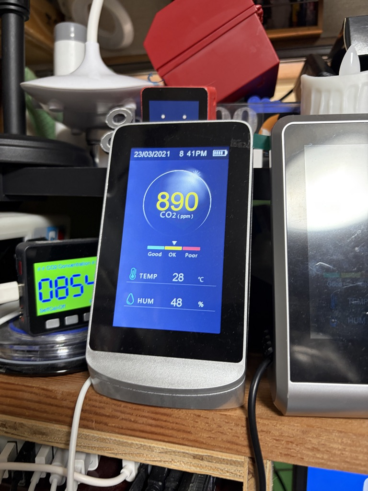
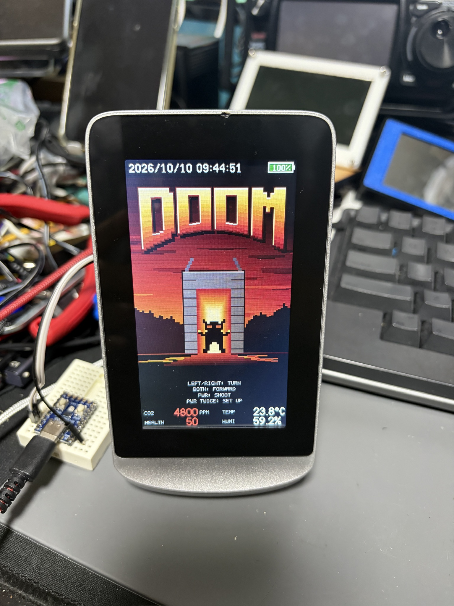
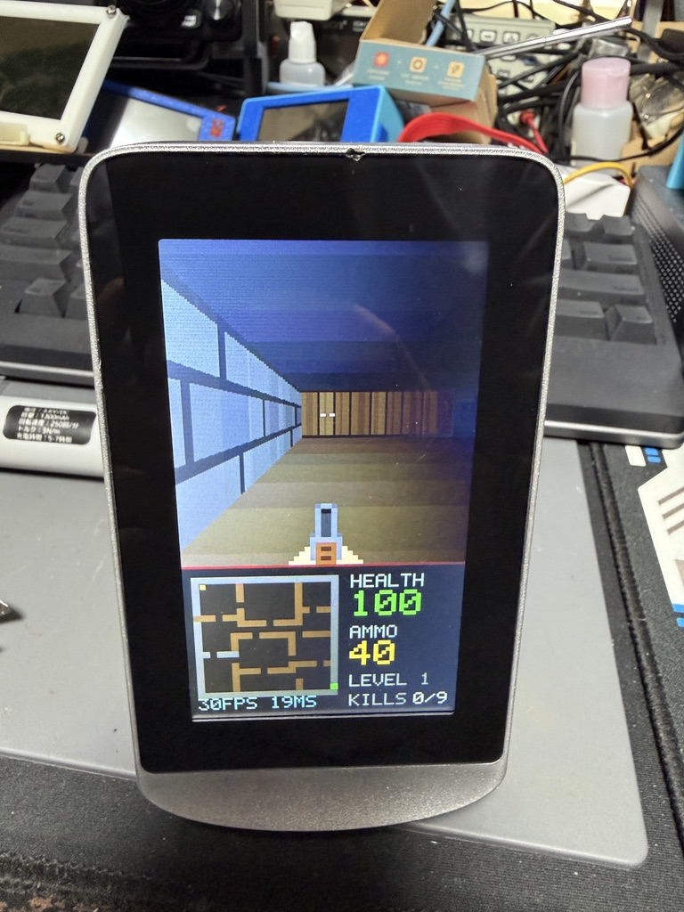
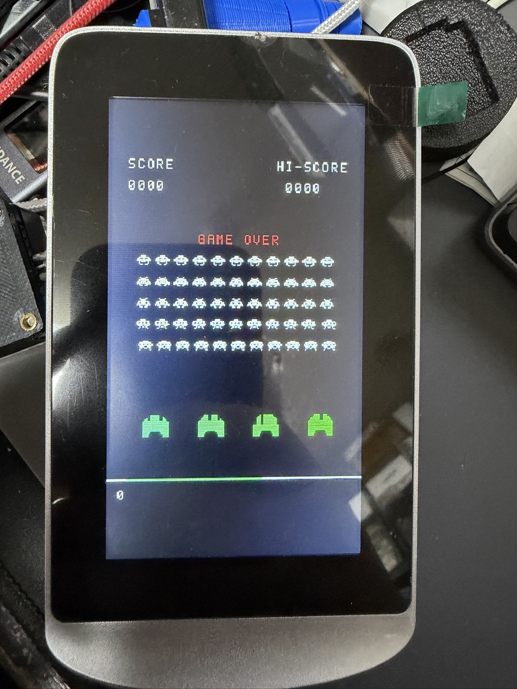
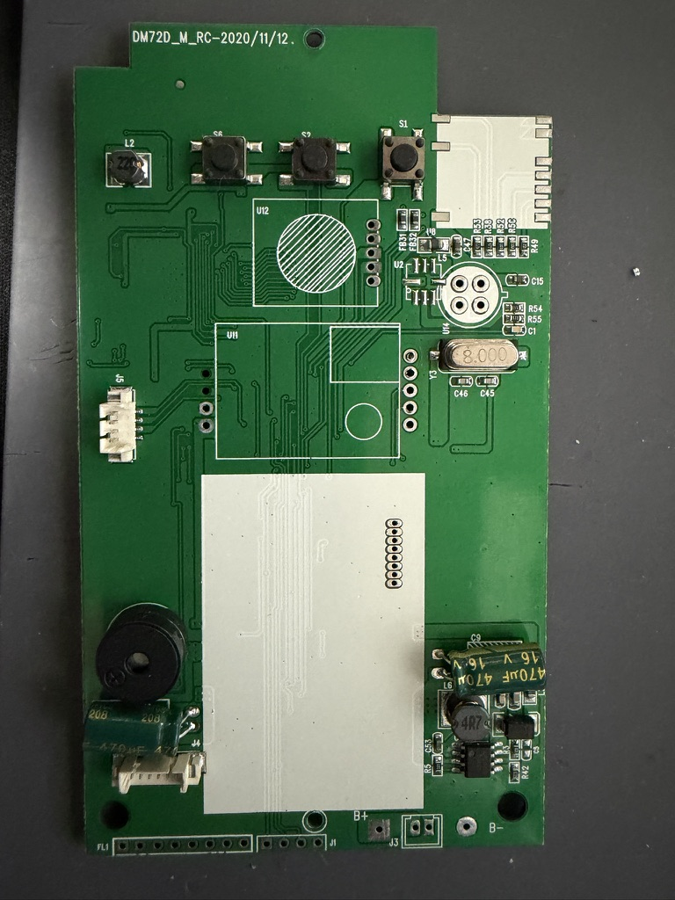
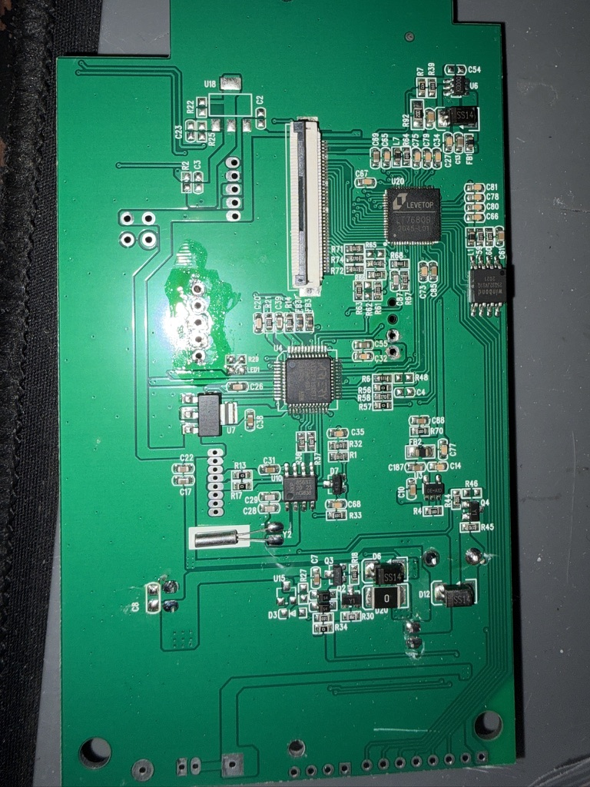

# CO2モニターDM72Cの解析と自作ファームウェア

CO2モニターDM72Cの基板（シルク`DM72D_M_RC`。AT32F415CBT7、LT7680B、4.3インチ480×272液晶）を解析し、その上で動くソフトウェアを自作した。

| 元の製品 | DOOM タイトル画面 | DOOM プレイ中 | ALIEN RAID |
|---|---|---|---|
|  |  |  |  |

| 基板（ボタン・J1側） | 基板（MCU・LT7680B側） |
|---|---|
|  |  |

## ドキュメント

| ファイル | 内容 |
|---|---|
| [doc/usage.md](doc/usage.md) | 使い方：電源の入れ方、DOOMとALIEN RAIDの操作、SET UP（時計合わせ）、部屋の快適度とHEALTH |
| [doc/組立.md](doc/組立.md) | 組立手順：分解、J1へのピンヘッダのハンダ付け、デバッガの組み立てと接続（写真付き） |
| [doc/debugger_connection.md](doc/debugger_connection.md) | デバッガの接続：RP2040-Zeroでのデバッガの作り方、J1の位置とピン配置、配線、接続確認 |
| [doc/flashing.md](doc/flashing.md) | 書き込み：電源とリセットの注意点、書き込みコマンド |
| [doc/openocd_setup.md](doc/openocd_setup.md) | OpenOCD（ArteryTek版）の環境構築 |
| [doc/flash_backup.md](doc/flash_backup.md) | 純正ファームとW25Q32のバックアップとリストア（`backup_flash`、`restore_flash`） |
| [doc/board_analysis.md](doc/board_analysis.md) | 基板の解析：部品、ピン配置、電源、純正ファームから分かったこと |
| [software/colorbar_sample/README.md](software/colorbar_sample/README.md) | カラーバーサンプル：MCUとLT7680Bの配線、液晶の設定 |
| [software/invaders/README.md](software/invaders/README.md) | ALIEN RAIDとW25Q32読み書きツール |
| [software/doomlike/README.md](software/doomlike/README.md) | DOOM：操作、描画方式、センサー、ホストシミュレータ |

## フォルダ構成

| フォルダ | 内容 |
|---|---|
| `doc/` | ドキュメント（上の表を参照） |
| `img/` | 製品、基板、各ソフトウェアの写真 |
| `software/colorbar_sample/` | LT7680Bのカラーバー表示サンプル（最初の動作確認用） |
| `software/invaders/` | ALIEN RAID（8080エミュレータ上で動くインベーダー風ゲーム）とW25Q32読み書きツール |
| `software/doomlike/` | DOOM（LT7680Bの矩形塗りつぶしだけで描くDOOM風レイキャスター） |
| `tools/` | `backup_flash`、`restore_flash`、`flash_doom`、`check_probe` は、どのディレクトリからでもmacOS/Linuxでは `tools/mac/<名前>.command`、Windowsでは `tools\win\<名前>.bat` で起動できる（中身は同名の `.py`）。`.command` はFinderからダブルクリックしても起動できる。`backup_flash.command` と `restore_flash.command` を引数なしで起動すると、`mcu`／`spiflash`／`all` を選ぶメニューが出る。`backup_flash.py`：MCU内蔵FlashとW25Q32をSWD経由でバックアップする。`restore_flash.py`：バックアップを書き戻して純正ファームに戻す。`flash_doom.py`：DOOMゲームをビルドして書き込む。`check_probe.py`：デバッガとSWDの接続を確認する。`openocd.py`：OSに合ったOpenOCDを起動するラッパー。`debugprobe_on_pico.uf2`：RP2040-Zeroをデバッガにするファーム（[doc/debugger_connection.md](doc/debugger_connection.md)） |

作者の個体から取得した純正ファームとW25Q32のダンプを `analysis/factory_dump/` に置いている（メーカーの著作物）。`tools/mac/restore_flash.command`（Windowsでは `tools\win\restore_flash.bat`）は、ディレクトリを指定しなければこのダンプを書き戻す。自分の個体のバックアップは `tools/mac/backup_flash.command`（`tools\win\backup_flash.bat`）で取得すると `backups/` に保存される（`.gitignore` で除外済み）。

## 要点

- MCUとLT7680BはSPI2でつながっている（CSはPB12）。LT7680Bには水晶がなく、PA8から8 MHzのクロックを供給されている
- 電源はPA7でラッチされているので、MCUがリセットされると電源が落ちる。また、純正ファームはWDTを使っている
- 書き込みはSWD（J1）で行う。J1は基板下端の4ピン端子で、ボタンを上にして右からGND、SWDIO、SWCLK、3.3 Vの順に並ぶ。接続方法は [doc/debugger_connection.md](doc/debugger_connection.md)、書き込み手順は [doc/flashing.md](doc/flashing.md) を参照
- W25Q32（4 MB）はLT7680BのSPIマスター（nSS1）経由でMCUから読み書きできる
