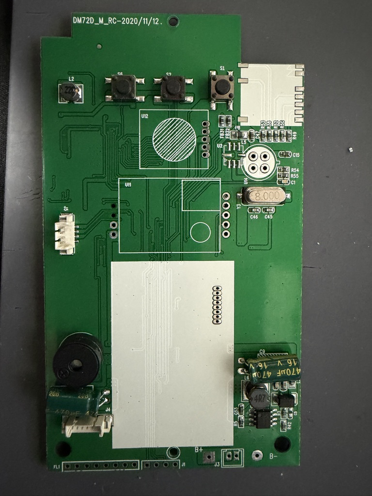
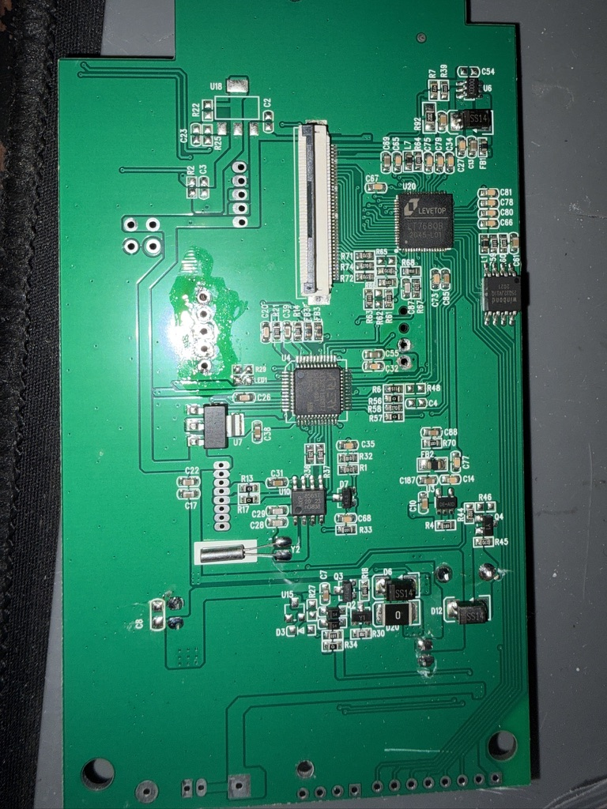
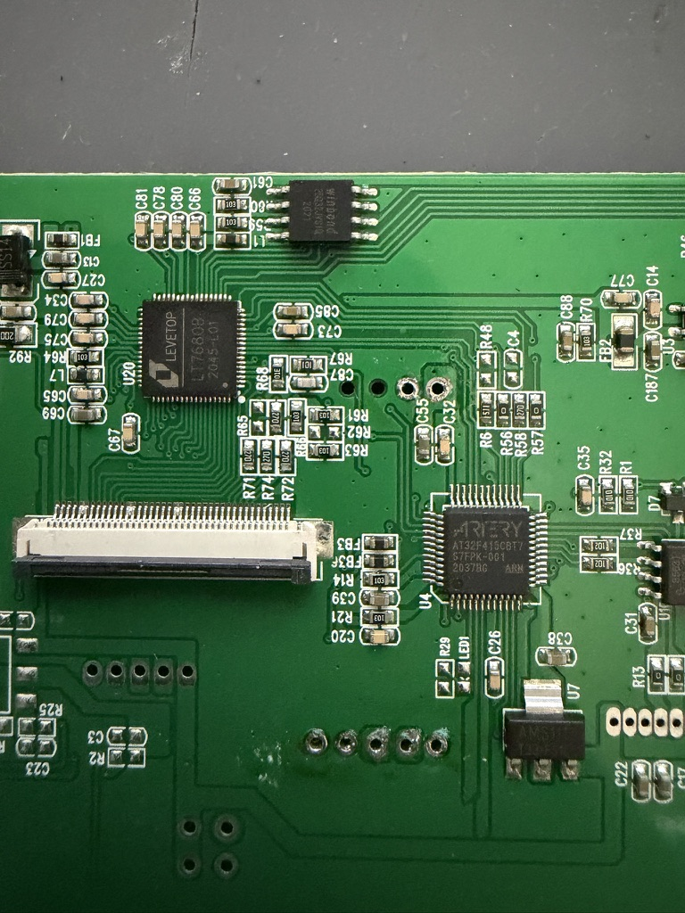

# DM72C 基板解析

CO2モニターDM72Cの基板（シルク`DM72D_M_RC`）の解析結果をまとめる。

この文書では、ボタン・ブザー・J1がある面を**ボタン面**（`OMOTE.jpeg`）、MCU・LT7680B・W25Q32がある面を**MCU面**（`URA.jpeg`）と呼ぶ。

## 写真

写真はリポジトリ直下の `img/` にある。

- `../img/board_overview.jpeg` — 基板全体
- `../img/main_components_closeup.jpeg` — MCU、表示コントローラ、Flash周辺の接写
- `../img/board_reverse.jpeg` — ボタン面（操作部、ブザー、電源、未実装モジュール領域）
- `../img/OMOTE.jpeg` — ボタン面
- `../img/URA.jpeg` — MCU面
- `../img/CPU_LCD-CONTROLLER.jpeg` — U4（AT32F415CBT7）とU20（LT7680B）の接写
- `../img/J1.jpeg` — J1の接写（`OMOTE.jpeg` から切り出し、ピン名を書き込んだもの）
- `../img/DEBUG_PROBE.JPG`、`../img/DEBUG_PROBE_pins.jpeg` — 使用しているデバッガ（RP2040-Zero＋debugprobeファーム。`_pins` はピン名入り）
- `../img/ORIGINAL.jpeg` — 純正ファームの表示
- `../img/DOOM_TITLE.jpeg`、`../img/DOOM.jpeg`、`../img/INVADER.jpeg` — 自作ソフトウェアの表示

 

## 成果物（`../software/`）

- `../software/colorbar_sample/` — LT7680B内蔵のカラーバーを表示する最小限のテストプログラム。実機で表示を確認済み
- `../software/invaders/` — 8080エミュレータ上でALIEN RAIDを動かすゲームと、W25Q32読み書きツール
- `../software/doomlike/` — DOOM（LT7680Bの矩形塗りつぶしで描くレイキャスター）。時計、電池残量、CO2・温湿度の表示付き

## 純正ファームとFlashのバックアップ（`analysis/factory_dump/`）

ダンプと、そこから取り出した画像（メーカーの著作物）を `analysis/factory_dump/` に置いている。自分の個体のダンプは `tools/mac/backup_flash.command`（Windowsでは `tools\win\backup_flash.bat`）で取得できる（[flash_backup.md](flash_backup.md)）。以下は各ファイルの説明。

- `factory_firmware.bin` — AT32F415の出荷時のFlash全体（128 KB、SHA256 `0ffef943…e230`）。読み出した時点でFAPは無効だった
- `user_system_data.bin` — ユーザーシステムデータ
- `w25q32_factory.bin` — W25Q32の出荷時の内容全体（4 MB、SHA256 `5b130150…d705`）。使用されているのは0x000000〜0x1063BF
- `flash_images/` — W25Q32から取り出した画像。全画面画像3枚（メイン、グラフ、電源OFF）と部品画像の一覧（`sprites_sheet.png`：SET UP画面、電池アイコン、4色の大きい数字、小さい数字、°C/°F）
- `at32f415_flash_backup.invalid-0bytes.bin` — 0バイトの無効なファイル。由来は不明で、どこからも参照していない

純正ファームから分かったこと：

- Keil＋AT32F4xx StdPeriphでビルドされている。Tuya MCU SDK形式の製品情報（`{"p":"ujwn2gjbdomubm5s",...}`）を含む
- 画面は縦向き（272×480）で使われているが、画像は480×272のパネルの向きのまま格納されている。部品画像の背景は水色（0x07FF）で、これが透明色として扱われる

## 実機で確定した事項

| 項目 | 内容 | 確認方法 |
|---|---|---|
| 電源保持 | PA7をHighにすると電源が保持され、Lowにすると切れる（PWRを押している間はPWR自体が通電させる） | SWDでPA7をLowにして確認 |
| PWR（電源ボタン） | PB2。押すとLow | 押している間のピン状態をサンプリング |
| その他のボタン | PB6、PB7。押すとLow | 純正ファームの解析と実機の操作 |
| ブザー | PA4。パッシブ型（他励式）のため、High固定ではクリック音しか出ない | SWDで駆動して確認 |
| W25Q32 | LT7680BのSPIマスターのnSS1に接続。JEDEC IDはEF4016。書き込み保護なし（SR1=00、SR2=02） | 読み出し・消去・書き込みで確認 |
| LT7680Bの汎用SPIマスター | REGB8がデータ、REGB9が制御（bit5＝nSS1、bit4＝CSアクティブ）、REGBAが状態、REGBBが分周 | 同上 |

## 概要

この基板は、AT32F415CBT7をメインMCU、LT7680BをTFT表示コントローラとし、RGBインターフェースの液晶パネルを駆動する構成である。

```text
外部センサー・キー・通信
          │
          ▼
 AT32F415CBT7（U4）
 メイン制御・演算・通信
     ├──── I²C ──── PCF8563（U10）
     │                  └─ Y2：32.768 kHz水晶
     │
     └──── SPI ──── LT7680B（U20）
                         ├─ SPI ─ W25Q32JV（U5、4 MB）
                         └─ RGB666＋同期信号 ─ TFT液晶FPC
```

## 主要部品

| 部品番号 | 型番・系列 | 役割 | 確度 |
|---|---|---|---|
| U4 | Artery AT32F415CBT7 | メインMCU | 高 |
| U20 | Levetop LT7680B | TFTグラフィックコントローラ | 高 |
| U5 | Winbond W25Q32JV系 | 32 Mbit（4 MB）SPI NOR Flash | 高 |
| U10 | NXP PCF8563系 | RTC（時計・カレンダー） | 高 |
| Y2 | 32.768 kHz水晶 | PCF8563用のRTCクロック | 高 |
| U7 | AMS1117-3.3 | 3.3 V LDOレギュレータ | 高 |
| U3/U6/U15 | 型番不明 | 電源の生成・監視・負荷制御用と思われる | 中 |
| D6/D12ほか | SS14 | ショットキーダイオード | 高 |

## 各ブロックの解析

### U4：AT32F415CBT7



- Arm Cortex-M4、最大150 MHz
- 内蔵Flash 128 KB
- SRAM 32 KB
- 電源電圧2.6〜3.6 V
- SPI、I²C、UART、CAN、USB、ADC、DMAなどを内蔵
- 装置全体の状態管理、センサー入力、通信、UI制御を担当していると考えられる

#### U4のピン配置（LQFP48）

AT32F415CBT7のパッケージはLQFP48。下表はICを上から見たときのデータシート上のピン番号で、基板上の接続先は別途導通を確認する必要がある。

| ピン | 信号 | ピン | 信号 | ピン | 信号 | ピン | 信号 |
|---:|---|---:|---|---:|---|---:|---|
| 1 | VBAT | 13 | PA3 | 25 | PB12 | 37 | PA14/SWCLK |
| 2 | PC13 | 14 | PA4 | 26 | PB13 | 38 | PA15 |
| 3 | PC14/LEXT_IN | 15 | PA5 | 27 | PB14 | 39 | PB3/SWO |
| 4 | PC15/LEXT_OUT | 16 | PA6 | 28 | PB15 | 40 | PB4 |
| 5 | PD0/HEXT_IN | 17 | PA7 | 29 | PA8 | 41 | PB5 |
| 6 | PD1/HEXT_OUT | 18 | PB0 | 30 | PA9 | 42 | PB6/I2C1_SCL |
| 7 | NRST | 19 | PB1 | 31 | PA10 | 43 | PB7/I2C1_SDA |
| 8 | VSSA | 20 | PB2/BOOT1 | 32 | PA11/USB D-/CAN RX | 44 | BOOT0 |
| 9 | VDDA | 21 | PB10/I2C2_SCL | 33 | PA12/USB D+/CAN TX | 45 | PB8 |
| 10 | PA0/WKUP | 22 | PB11/I2C2_SDA | 34 | PA13/SWDIO | 46 | PB9 |
| 11 | PA1 | 23 | VSS | 35 | PF6 | 47 | VSS |
| 12 | PA2 | 24 | VDD | 36 | PF7 | 48 | VDD |

接続先として確度が高いもの：

- Y3（8.000 MHz）→ 5番ピン PD0/HEXT_IN、6番ピン PD1/HEXT_OUT
- SWD書き込み → 34番ピン PA13/SWDIO、37番ピン PA14/SWCLK、7番ピン NRST、3.3 V、GND
- LT7680BのSPI → **SPI2で確定**：PB12＝SCS#、PB13＝SCLK、PB14＝SDO、PB15＝SDI
- LT7680BのXI → **PA8で確定**：8 MHzのクロック（純正ファームはTMR1 CH1のPWMで生成している）。LT7680B側に水晶はない
- 電源 → 24/48番ピン VDD、23/47番ピン VSS、9番ピン VDDA、8番ピン VSSA

#### デバッグ端子の候補

U7（AMS1117-3.3）の下、U4の左側に縦一列に並ぶ8ピンのランドは、導通を調べるとPB10/PB11につながっていた。したがってJTAG/SWD端子ではなく、I2C2、USART3、RTC周辺、または外部モジュール用の端子である可能性が高い。

AT32F415でフルJTAGを使う場合に必要な8信号：

| 信号 | MCUのピン |
|---|---|
| JTMS / SWDIO | PA13（34番ピン） |
| JTCK / SWCLK | PA14（37番ピン） |
| JTDI | PA15（38番ピン） |
| JTDO / SWO | PB3（39番ピン） |
| NJTRST | PB4（40番ピン） |
| NRST | 7番ピン |
| VREF | 3.3 V |
| GND | VSS |

実機で調べた結果、ボタン面の下端にあるJ1が4ピンのSWDデバッグ端子（右からGND、SWDIO、SWCLK、3.3 V。NRSTはなし）で、FL1は別用途だった。U7の下の8ピン列もJTAG/SWD端子ではない。J1の位置、配線、接続の記録は [debugger_connection.md](debugger_connection.md)、書き込み手順は [flashing.md](flashing.md) にまとめてある。

### U20：LT7680B

- 最大480×320のRGB TFTに対応した表示コントローラ
- RGB565/RGB666、最大18ビット出力
- AT32F415とはSPIで接続されている（SPI2で確定）
- フレームバッファ、図形描画、文字描画、BTE転送、PIP、透過処理、PWMを内蔵
- FPCへ向かう並列配線は、RGBデータ18本、PCLK、HSYNC、VSYNC、DEと推定される

### U5：W25Q32JV

- 容量32 Mbit（4 MB）
- 電源電圧2.7〜3.6 V
- SPI/Dual SPI/Quad SPI対応
- LT7680BのSPIマスターに接続されている（実機で確定）
- 画像、アイコン、フォント、起動画面などの格納に使われている

480×320、RGB565の非圧縮画像は1枚307,200バイトなので、4 MBには理論上約13画面分を格納できる。実際にはフォント、アイコン、管理領域なども含むため、全画面画像なら10〜12枚程度が目安になる。

### U7：AMS1117-3.3

- 基板の3.3 Vロジック電源を生成するLDOレギュレータ
- AT32F415、LT7680B、W25Q32JV、PCF8563などに給電していると考えられる
- AMS1117系は入出力間に約1 V以上の電位差が必要なので、入力は5 V系と考えられる
- 実際に流せる電流は、入力電圧、基板の銅箔面積、周囲温度による放熱の制約を受ける
- 入出力コンデンサの容量とESRが安定性に影響する。C38とその周辺のコンデンサがこの役割を担っていると考えられる

### U10：PCF8563

- I²C接続のRTC
- 7ビットI²Cアドレスは通常0x51
- Y2の32.768 kHz水晶で時計を刻む
- 日時、曜日、アラーム、タイマー割り込みの機能を持つ
- 周辺のR13/R17は、I²Cのプルアップか割り込み信号用の可能性がある

### TFT用FPC

推定される信号は次のとおり。

- LCD電源、GND
- R0〜R5、G0〜G5、B0〜B5
- PCLK、HSYNC、VSYNC、DE
- LCDのリセットまたはイネーブル
- バックライトLED+、LED−
- パネルによってはタッチパネルの信号

正確なピン配列を知るには、液晶パネルの型番を調べるか導通を測定する必要がある。

## 電源回路

SS14ショットキーダイオード、複数の小型IC、トランジスタ、0 Ω抵抗が基板上に分散して配置されている。想定される電源系統は次のとおり。

```text
外部入力
 ├─ 3.3 Vロジック：AT32F415、LT7680B、W25Q32JV、PCF8563
 ├─ LCDロジック電源
 ├─ LCDバックライト電源
 └─ RTCバックアップ電源または逆流防止経路
```

U7はAMS1117-3.3で、入力電源から3.3 Vのロジック電源を生成する。下部のSS14、Q3、Q4、U3、U15の周辺は、電源切り替え、逆流防止、バックライトや外部負荷の駆動回路と考えられる。

## ボタン面の解析

写真：`../img/OMOTE.jpeg`

### 基板の識別

- シルク印刷：`DM72D_M_RC-2020/11/12`
- 2020年11月12日版の設計データまたは製造データであることを示していると思われる

### 操作部

- 上端にタクトスイッチが3個ある
- シルクは左からS6、S2（PWRボタン）、S1（`../img/OMOTE.jpeg`）
- 各スイッチからMCU方向へ独立した配線が伸びており、GPIO入力と考えられる（PWR＝PB2、他の2つはPB6/PB7で確定）
- L2は表示灯か照明用の部品と思われるが、型番は確認できていない

### クロック

- Y3は8.000 MHzの水晶
- C45/C46は水晶の負荷容量と考えられる
- AT32F415の外部高速クロック源である（純正ファームがHEXTを使っていることで確定）
- Y2の32.768 kHz水晶はU10（PCF8563）のRTCクロック

### 音響出力

- 左下に大型のブザー（サウンダー）がある。PA4で駆動するパッシブ型（実機で確定）
- 近くの電解コンデンサとJ4コネクタは、音響出力か外部負荷の接続に関係していると思われる
- 駆動回路の詳細は、MCU面のトランジスタ回路を含めて導通確認が必要

### バッテリー・電源入力

- 下端に`B+`、`B-`の表示がある
- J3付近がバッテリーまたはDC電源の接続部と考えられる
- 右下に8ピンの電源IC、`4R7`のインダクタ、470 µF/16 Vの大容量電解コンデンサがあり、スイッチング電源を構成している
- この回路が降圧、昇圧、バックライト電源のどれなのかは、ICのマーキングを読み、導通を測定しないと分からない
- AMS1117-3.3は、この電源系統から3.3 Vのロジック電源を生成していると考えられる

### 未実装のモジュール領域

- U11とU12には、大きなモジュール用と思われる未実装のフットプリントがある
- U12は中央に円形のシルクがあり、側面に接続用の穴があるので、センサーか操作部品用と思われる
- U11は多数の信号配線を持つ大型のモジュール領域で、製品バリエーション用のセンサーか通信モジュール用と思われる
- U14は4端子の円形フットプリントで、センサー、マイク、操作部品などが候補だが、特定できていない
- U2/L5付近と右上の白い領域には高周波回路のようなパターンが見えるが、アンテナや無線回路と断定するには、さらに接写と導通確認が必要

### コネクタ・テスト端子

- J6は5ピンのコネクタで、外部センサーかサブ基板の接続用と思われる
- 下端のJ1は4ピンのSWD端子。写真の右からGND、SWDIO、SWCLK、3.3 V（[debugger_connection.md](debugger_connection.md)）
- FL1はJ1とは別用途の多ピンの未実装端子で、製造時の検査用か製品バリエーション用の接続と思われる
- U11/U12の周辺にも未実装のピン列があり、モジュールの接続用か評価用と考えられる

## 未実装の回路

U18、LED1、いくつかの抵抗とコンデンサ、ピンヘッダ用のランドが未実装になっている。同じPCBを複数の仕様で共用している可能性が高い。0 Ω抵抗は、機能の選択、電源の選択、信号経路の切り替え、デバッグ時の切り離しに使われていると考えられる。

## SWDで判明した事項（純正ファーム動作中のレジスタと逆アセンブルから）

| 項目 | 内容 |
|---|---|
| システムクロック | HEXT 8 MHz（Y3）× PLL 6 = 48 MHz、APB1は24 MHz |
| 電源保持 | PWRが電源ボタン。MCUの出力で電源をラッチしているので、MCUがリセットされると電源が落ちる |
| ウォッチドッグ | 純正ファームはWDTを起動する。デバッガでhaltしたままにするとWDTでリセットされ、電源が落ちてSWDがつながらなくなる |
| UART | USART1（PA9/PA10）、USART2（PA2/PA3）、USART3（PB10/PB11）を受信割り込み付きで使用。9600 bpsの設定がある |
| ソフトウェアI²C | PB0/PB1とPB3/PB4でビットバングの通信を行う。PB2/PB5/PB6/PB7は入力 |
| ソフトウェアUART送信 | PA0（8ビット、LSBファーストのビットバング） |
| アナログ入力 | ADC1、PA5/PA6 |
| PA1 | 入力として読み取っている（ボタンなど） |

## 未確定の事項

- U3、U6、U15、上端のICの正確な型番
- FPCコネクタのピン配列
- 電源の入力電圧と各電源レールの電圧
- 基板下端・側面のコネクタの用途
- 右下のスイッチング電源ICの型番と出力電圧
- U11、U12、U14に載る予定の部品
- 右上の白い領域が、アンテナ、タッチ電極、それ以外のどれなのか

## 今後の調査に必要な情報

1. 液晶パネルの型番
2. U3、U6、U15、上端のIC、右下の電源ICの接写
3. U11/U12/U14付近と右上の白い領域の接写
4. コネクタを含む基板の端の写真
5. 電源OFF状態での導通測定
6. 動作中の3.3 V、5 V、バックライトの電圧

## 参考資料

- Levetop LT768x 公式データシート：https://www.levetop.cn/uploadfiles/2023/05/LT768x_DS_V42_ENG.pdf
- Levetop LT768x 公式資料一覧：https://www.levetop.cn/en/Download/list.aspx?lcid=243&pid=243
- Artery AT32F415 製品情報：https://atkap.arterytek.com/en/product/AT32F415.jsp
- Winbond W25Q32JV 製品情報：https://www.winbond.com/hq/product/code-storage-flash/qspi-nor/w25q-jv/?__locale=ja&partNo=W25Q32JVSSIQ

## 注意

写真からの解析には推定が含まれている。特に電源端子、書き込み端子、FPCのピン配列については、導通を確認する前に外部電源やプログラマを接続しないこと。
