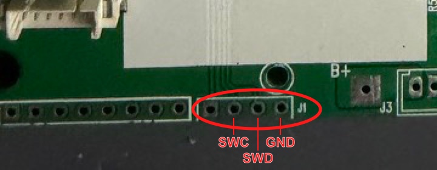
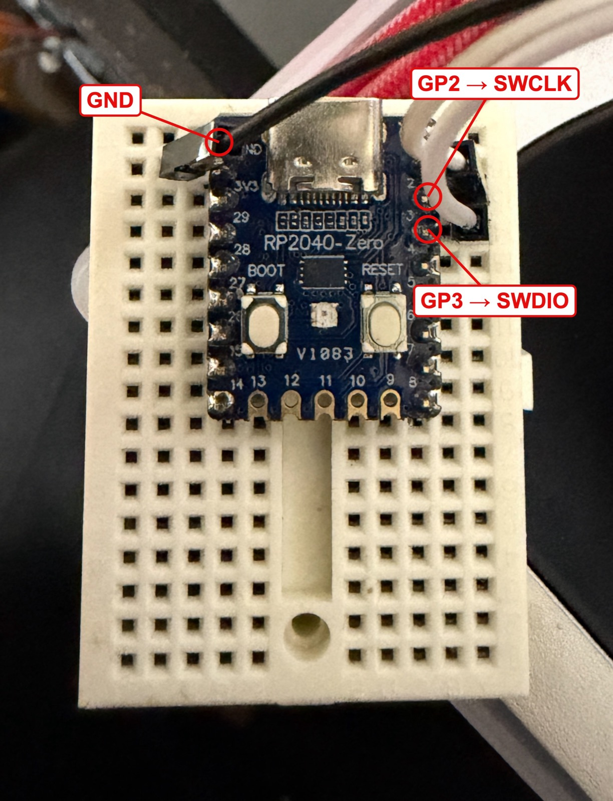

# デバッガの接続

デバッガ（RP2040-Zero）の作り方、J1との配線、接続確認の方法をまとめる。書き込みは [flashing.md](flashing.md)、OpenOCDの導入は [openocd_setup.md](openocd_setup.md)、純正ファームのバックアップは [flash_backup.md](flash_backup.md) を参照。

## 必要なもの

- Waveshare RP2040-Zeroにdebugprobeファームを書き込んだデバッガ（作り方は後述の「デバッガの作り方」）。CMSIS-DAPv2（VID:PID `2E8A:000C`）として認識され、macOSではドライバは不要
- ChromeかEdge（Web版の書き込みツールを使う場合）。コマンドライン版を使う場合は、ArteryTek版OpenOCD（`tool-openocd-at32`）。環境構築は [openocd_setup.md](openocd_setup.md) を参照

## J1の位置とピン配置

J1は、基板のボタンがある面（[`../img/OMOTE.jpeg`](../img/OMOTE.jpeg)）の下端中央、シルク`J1`の左にある4つの穴。ボタンを上にして、**右からGND、SWDIO、SWCLK、3.3 V**の順に並ぶ（左端が1番ピン、右端が4番ピン）。



| J1のピン | 信号 | MCU側 |
|---:|---|---|
| 1（左端） | 3.3 V / VREF | VDD |
| 2 | SWCLK | PA14（MCUの37番ピン） |
| 3 | SWDIO | PA13（MCUの34番ピン） |
| 4（右端） | GND | VSS |

J1にはNRSTが出ていないので、connect under resetは使えない。PA15/JTDI、PB3/JTDO-SWO、PB4/NJTRSTも出ておらず、JTAGには使えないSWD専用の端子である。また、AT32F415ではSWDIO/SWCLKを別のピンにリマップできない。

## 配線

RP2040-ZeroとJ1を3本の線でつなぐ。RP2040-Zeroのシルクの数字はGP番号を表す。以下はUSBコネクタを上にして見た位置。



| RP2040-Zero | 位置（USBコネクタが上） | 信号 | J1 |
|---|---|---|---|
| GND | 左列の上から2番目（5Vの下） | GND | 4番ピン（右端） |
| GP2（シルク`2`） | 右列の上から3番目 | SWCLK | 2番ピン |
| GP3（シルク`3`） | 右列の上から4番目 | SWDIO | 3番ピン |
| 3V3 | 左列の上から3番目 | — | 接続しない（1番ピンは空けておく） |

- J1の3.3 Vにはつながない。デバッガから基板へは給電しない
- 配線はできるだけ短くし、GNDを確実に接続する。必要に応じてSWCLKとSWDIOに100 Ω程度の抵抗を直列に入れる
- Raspberry Pi Pico（GP2/GP3/GND、ファームも同じ）や、製品版のRaspberry Pi Debug Probe（`D`端子のオレンジのSCを2番ピン、黄色のSDを3番ピン、黒のGNDを4番ピンへ）でも同じようにつなげる

## デバッガの作り方

RP2040-ZeroにRaspberry Pi公式のdebugprobeファーム（Pico用）を書き込むと、CMSIS-DAPデバッガとして使える。ピン割り当てはPicoと同じ。

1. https://github.com/raspberrypi/debugprobe/releases から最新の **`debugprobe_on_pico.uf2`** をダウンロードする。`debugprobe.uf2` は製品版Debug Probe用なので使わない。同じファイル（無改変）を [`../tools/debugprobe_on_pico.uf2`](../tools/debugprobe_on_pico.uf2) にも置いてあるので、それを使ってもよい（ライセンスは [`../tools/debugprobe_on_pico.LICENSE.txt`](../tools/debugprobe_on_pico.LICENSE.txt)）
2. RP2040-ZeroのBOOTボタンを押したまま、USB-CケーブルでPCにつなぐ（すでにつないである場合は、BOOTを押したままRESETを押して離す）。`RPI-RP2` というドライブが現れる
3. `debugprobe_on_pico.uf2` を `RPI-RP2` にコピーする。コピーが終わると自動的に再起動し、ドライブが消える
4. USBデバイスとして `Debugprobe on Pico (CMSIS-DAP)`（VID:PID `2E8A:000C`）が現れれば完成。macOSでは次のコマンドで確認できる

```sh
system_profiler SPUSBDataType | grep -i -A6 debugprobe
```

あとは「配線」の表のとおり、GP2、GP3、GNDをJ1につなぐ。GP4/GP5はUART（TX/RX）だが、この基板では使わない。

## 接続確認

基板の電源は**PWRボタンを1秒押して**入れる。デバッガからは給電しない。自作ファームの動作中（LT7680Bと液晶が動いている間）は、DPは見えてもメモリアクセスに失敗するので、**PWRを押したまま**接続する。

Web版の書き込みツールで確認する（[flashing.md](flashing.md) の「ブラウザから書き込む」）。`tools/mac/web_flasher.command`（Windowsでは `tools\win\web_flasher.bat`）でページを開き、「デバッガを選ぶ」でdebugprobeを選んでから「接続を確認」を押す。「OK: AT32F415に接続できた」と表示されれば接続できている。CPUは止めない。Web版はブラウザがデバッガを直接使うので、OpenOCDを動かしたままだとデバッガを開けない。

コマンドライン版では、次のコマンドで同じ確認ができる。どのディレクトリから実行してもよい。`OK: the debugger is connected to the AT32F415.` と表示されれば接続できている。haltもresetもしない。

```sh
./tools/mac/check_probe.command      # macOS/Linux
tools\win\check_probe.bat            # Windows
```

OpenOCDを直接使う場合は、リポジトリのルートで次のコマンドを実行する。`SWD DPIDR 0x2ba01477` と `Cortex-M4 r0p1 processor detected` が表示されれば接続できている。`reset` を含むコマンドは、MCUがリセットされて電源が落ちるので使わないこと（[flashing.md](flashing.md) の「電源とリセットの注意点」を参照）。

```sh
python3 tools/openocd.py \
  -f interface/cmsis-dap.cfg -f target/at32f415xx.cfg -c "adapter speed 1000" \
  -c "init; targets; exit"
```

| 表示（Web版／コマンドライン版） | 原因と対処 |
|---|---|
| 「デバッガを選ぶ」の一覧に出ない／`unable to find a matching CMSIS-DAP device` | デバッガがUSBで認識されていない。挿し直してから再試行する |
| 「デバッガを開けない」 | OpenOCDなど、ほかのアプリがデバッガを使っている。終了してから再試行する |
| 「MCUが応答しない」／`Error connecting DP: cannot read IDR` | 基板の電源が切れている（PWRで入れる）。自作ファームの動作中であれば、PWRを押したまま接続する。それでもだめなら、GP2とGP3の配線が逆になっていないか、GNDがつながっているかを確認する |

## これまでの記録

- 2026-10-09：純正ファームの動作中は接続が不安定だった（10 kHzでも100 kHzでも大半が `cannot read IDR` になり、つながってもメモリアクセス中に切れることが多かった）。その後、WDTを止めてからhaltする手順（[flashing.md](flashing.md)）にしたところ、内蔵Flashのバックアップと書き込みができた（[flash_backup.md](flash_backup.md)）
- 2026-10-10：RP2040-Zeroのデバッガを使い、1 MHzで接続、書き込み、照合（`verify_image`）ができることを確認した。基板の電源が切れていると `cannot read IDR` になる
