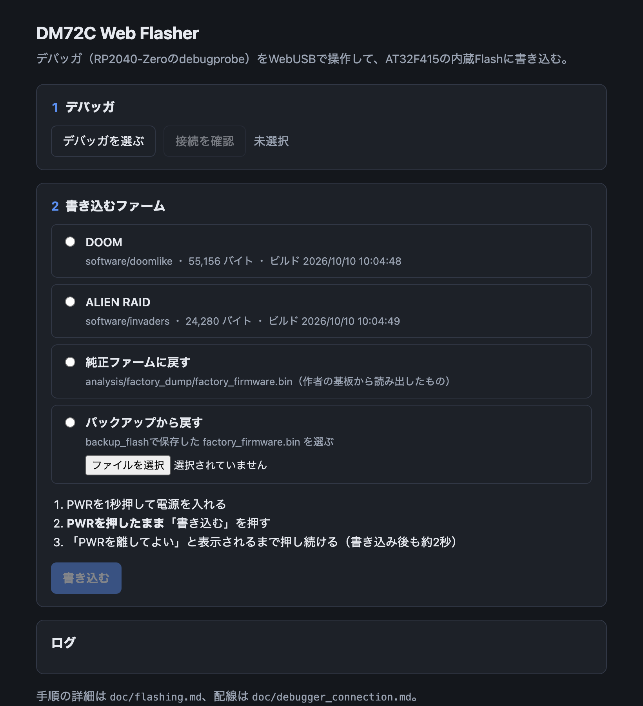

# 書き込み

自作ファームと純正ファームを、SWD経由でAT32F415の内蔵Flashに書き込む手順。PCに入れるもの（Python、ブラウザ、PlatformIO）は [setup.md](setup.md)、デバッガの準備と配線は [debugger_connection.md](debugger_connection.md) を参照。

ふだんは**ブラウザから書き込むWeb版**を使う。OpenOCDのコマンドで書き込むコマンドライン版は、末尾の「付録」にまとめた。

## 書き込み前の注意

1. バッテリーを十分に充電しておく
2. 書き込み中は、充電用のUSBケーブルを接続しない（CO2センサーのマイコンとデバッガの電源電圧が異なると、書き込みが不安定になるため）

## ブラウザから書き込む（Web版、`web_flasher`）

ブラウザからDOOM、ALIEN RAID、純正ファームを書き込める。OpenOCDは使わず、ページがWebUSBでデバッガ（debugprobe）を直接操作する。ChromeかEdgeが必要（SafariとFirefoxはWebUSBに対応していない）。



### 起動

```sh
./tools/mac/web_flasher.command             # 2つのゲームをビルドしてからページを開く
./tools/mac/web_flasher.command --no-build  # ビルド済みのfirmware.elfを使う
```

Windowsでは `tools\win\web_flasher.bat` を使う。`tools/web_flasher.py` がゲームを `.bin` に変換して `tools/web/firmware/` に置き、リポジトリを `http://localhost:8737/` で配信して `tools/web/` をChrome（なければEdge）で開く。終了するにはターミナルでCtrl+Cを押す。WebUSBはlocalhostかHTTPSでしか使えないので、HTMLファイルを直接開いても動かない。

### 操作

1. 「デバッガを選ぶ」でdebugprobe（`Debugprobe on Pico (CMSIS-DAP)`）を選ぶ。2回目からは自動で選ばれる
2. 「接続を確認」で `check_probe` と同じ確認（DPIDR、CPUID、Flash容量）ができる。CPUは止めない
3. 書き込むファームを選ぶ。「純正ファームに戻す」は `analysis/factory_dump/factory_firmware.bin` を、「バックアップから戻す」は自分で選んだ `factory_firmware.bin`（`backups/*/`）を書く。どちらも128 KBであることとSHA256を確認し、作者のダンプと違うときは確認のダイアログを出す
4. PWRを1秒押して電源を入れ、**PWRを押したまま**「書き込む」を押す。「PWRを離してよい」と表示されるまで押し続ける（書き込み後も約2秒）。終わると `g_diag` を読んで、ゲームが起動したかを表示する

書き込みに失敗したら、ページ下のログを見る。接続できないときの原因は [debugger_connection.md](debugger_connection.md) の表を参照。

### 仕組み

中で行う手順は、コマンドライン版の `flash_doom` と同じ（`reset halt`、WDT・SysTick・割り込みの停止、書き込み、照合、`reset run`、2秒待ってから `g_diag` の確認、失敗時は最大3回やり直し）。Flashの消去はSWDからレジスタを直接操作し、書き込みはSRAMに置いた小さなルーチン（`tools/web/stub/flash_stub.S`）で行う。ファイルの役割：

| ファイル | 役割 |
|---|---|
| `tools/web/dap.js` | CMSIS-DAP v2（WebUSB）、SWD、メモリアクセス、Cortex-Mの停止・リセット |
| `tools/web/at32.js` | AT32F415の内蔵Flashの消去・書き込み・照合（1 KBセクタ、128 KB） |
| `tools/web/app.js`、`index.html` | 画面 |
| `tools/web/stub/` | 書き込みルーチンのソースと、`at32.js` に貼るバイト列を出す `build_stub.sh` |

W25Q32のバックアップと復元は、Web版にはない（コマンドライン版の `backup_flash`、`restore_flash` を使う。[flash_backup.md](flash_backup.md)）。

## 電源とリセットの注意点

- 基板の電源は**PWRボタンを1秒押して**入れる。デバッガからは給電しない
- 電源はPA7のラッチで保持されていて、MCUがリセットされるとラッチが外れて電源が落ちる。このため `pio run -t upload`（OpenOCDの `program`）は使えない。haltしてから書き込み、最後に `reset run` で起動する
- PWRを押している間はボタン自体が通電させるので、リセットしても電源は落ちない
- 自作ファームの動作中（LT7680Bと液晶が動いている間）は、DPは見えてもメモリアクセスに失敗する。接続と書き込みは**PWRを押したまま**行う。なお、DOOMはhaltされると電源OFFの長押し時間を数えなくなる
- Flashが空、または壊れている（電源を保持するファームがない）ときは、書き込みが終わるまでPWRを押し続ける
- 純正ファームはWDTを使っている。haltしたままだとWDTでリセットされて電源が落ちるため、halt直後に `mww 0xE0042004 0x300`（`DEBUG_CTRL` でWDTとWWDTを停止）を実行する

## 付録：コマンドラインから書き込む

OpenOCD（[openocd_setup.md](openocd_setup.md)）を使う方法。Web版と同じことができ、ほかに `colorbar_sample` やW25Q32読み書き用ファームも書き込める。

### DOOMゲームの書き込み（`flash_doom`）

DOOMゲーム（`software/doomlike`）は、次のコマンドでビルドから書き込みまでを行える。どのディレクトリから実行してもよい。中で実行するのは、次の「書き込みコマンド」の `halt` を `reset halt` に置き換えた手順。

```sh
./tools/mac/flash_doom.command             # pio runでビルドしてから書き込む
./tools/mac/flash_doom.command --no-build  # ビルド済みのfirmware.elfを書き込む
```

Windowsでは `tools\win\flash_doom.bat`、Finderからは `tools/mac/flash_doom.command` をダブルクリックする。`-y` を付けると、Enterを待たずに書き込む。

「Hold PWR and press Enter」と表示されたら、PWRを押したままEnterを押し、「Done. PWR can be released.」と表示されるまで押し続ける。DOOMはリセット後、PWRが1秒押され続けて初めて電源ラッチをかけるので、書き込み後も約2秒押し続けるよう表示が出る。そのあと `g_diag` をSWDで読み、起動できたか（`stage 0x3 (running)`）を表示する。起動していなければ「DOOM did not start」と `g_diag` の値を表示する。

DOOMの動作中にhaltして書き込むと、消去の直後に `timeout waiting for algorithm` で書き込みに失敗する。リセット直後のMCUになら書き込める（2026-11-19に確認。動作中のクロックや周辺機能のどれが原因かは未特定）。このため `flash_doom.py`（と `flash_invaders.py`）は、PWRを押したまま `reset halt` してから書き込む（PWRを押していればリセットしても電源は落ちない）。それでも失敗した場合は、最大3回までやり直す。

### ALIEN RAIDの書き込み（`flash_invaders`）

ALIEN RAID（`software/invaders`）も同じ手順で書き込める。使い方と表示は `flash_doom` と同じで、`g_diag` は `frames` と `late frames`（60 Hzに間に合わなかったフレーム数）を表示する。ビルドするのはゲーム本体（`env:at32f415cbt7`）だけで、W25Q32読み書き用ファーム（`env:sflash`）は含まない。

```sh
./tools/mac/flash_invaders.command             # pio runでビルドしてから書き込む
./tools/mac/flash_invaders.command --no-build  # ビルド済みのfirmware.elfを書き込む
```

Windowsでは `tools\win\flash_invaders.bat` を使う。共通の処理は `tools/flashfw.py` にある。

### 書き込みコマンド（OpenOCDを直接使う）

各プロジェクトのディレクトリ（`software/<name>/`）で `pio run` を実行してビルドしたあと、次のコマンドを実行する。

```sh
python3 ../../tools/openocd.py \
  -f interface/cmsis-dap.cfg -f target/at32f415xx.cfg -c "adapter speed 1000" \
  -c "init; halt; cortex_m maskisr on; mww 0xE0042004 0x300; mww 0xE000E010 0; mww 0xE000E180 0xFFFFFFFF; mww 0xE000E280 0xFFFFFFFF; flash write_image erase .pio/build/at32f415cbt7/firmware.elf; verify_image .pio/build/at32f415cbt7/firmware.elf; cortex_m maskisr auto; reset run; exit"
```

DOOMなどの自作ファームが動いている上に書き込むときは、`halt` を `reset halt` に置き換え、PWRを押したまま実行する（上の「DOOMゲームの書き込み」を参照）。

| 書き込むもの | ELFファイル |
|---|---|
| `software/colorbar_sample`、`software/invaders`、`software/doomlike` | `.pio/build/at32f415cbt7/firmware.elf` |
| W25Q32読み書き用ファーム（`software/invaders` で `pio run -e sflash`） | `.pio/build/sflash/firmware.elf` |

各操作の意味：

| 操作 | 目的 |
|---|---|
| `halt` | リセットすると電源が落ちるので、CPUを止めた状態で書き込む。自作ファームの動作中は、PWRを押したまま `reset halt` にする |
| `cortex_m maskisr on` | ステップ実行中の割り込みを禁止する |
| `mww 0xE0042004 0x300` | halt中はWDTとWWDTを止める |
| `mww 0xE000E010 0` | SysTickを止める |
| `mww 0xE000E180 0xFFFFFFFF`、`mww 0xE000E280 0xFFFFFFFF` | NVICの割り込みをすべて無効にし、保留中の割り込みをクリアする |
| `reset run` | 新しいファームで起動する（PA7のラッチは新しいファームがかけ直す） |

割り込み（SysTickやサウンド用の48 kHz TMR3など）を止めておかないと、書き込み中に発生した割り込みが消去済みのベクタテーブルへ飛び、書き込みがタイムアウトする。

`verify_image` で `checksum mismatch - attempting binary compare` と表示されることがあるが、続くバイト単位の比較で差分が出なければ問題ない。
