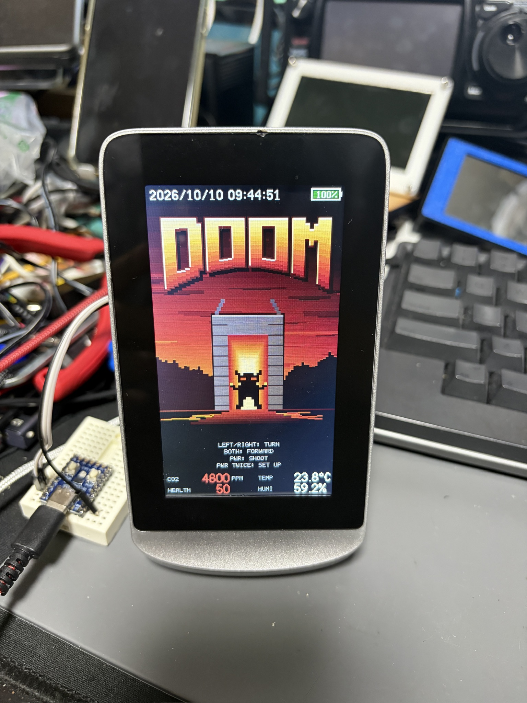
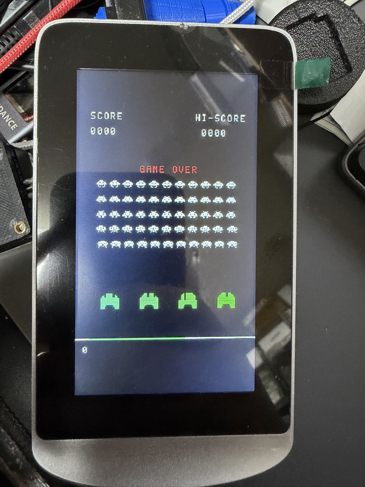

# 使い方

自作ファームを書き込んだDM72Cの操作方法をまとめる。書き込み方は [flashing.md](flashing.md) を参照。

ボタンは3つある。この文書では、画面を正面から見て**左ボタン**、**真ん中のPWRボタン**、**右ボタン**と呼ぶ。

| ボタン | 基板のシルク | MCUのピン |
|---|---|---|
| 左ボタン | — | PB7 |
| PWRボタン（真ん中） | S2 | PB2 |
| 右ボタン | — | PB6 |

## 電源

- 電源ON：PWRを1秒押す
- 電源OFF：PWRだけを5秒押し続けてから離す
- PWRを押している間はボタン自体が通電させるので、5秒経っても指を離すまでは電源が切れない

## DOOM（`software/doomlike`）

### タイトル画面

- 上段：日付、時刻（秒まで）、電池残量（電池アイコンの中に%で表示。50 %以下で黄色、20 %以下で赤になる）
- 下段：CO2（ppm）、HEALTH（このゲームを始めたときのHEALTH）、TEMP（°C）、HUMI（%）。センサーから値を取得できないときは `----` と表示する
- PWRを1回押して離すとゲームが始まる
- PWRを2回続けて押すとSET UP画面が開く
- PWRを5秒長押しすると電源が切れる（タイトル画面のみ。ゲーム中は切れない）

### ゲーム

| ボタン | 動作 |
|---|---|
| 左ボタン | 左を向く |
| 右ボタン | 右を向く |
| 左右同時押し | 前進 |
| PWR | 撃つ |

- 全3面。インプは火の玉を投げてくる。ブルートは近づいてきてかみつく。回復アイテムと弾薬の箱が落ちている
- 緑の出口スイッチに触れると面クリア。3面すべてクリアするとYOU WIN!と表示され、PWRでタイトル画面に戻る
- HEALTHが0になるとYOU DIED。5秒経つか、PWRを押すとタイトル画面に戻る

### 部屋の快適度とHEALTH

CO2、温度、湿度から部屋の快適度（0〜100）を計算し、それをもとにゲーム開始時のHEALTHを決める。

| センサー | 100点の範囲 | 減点 |
|---|---|---|
| CO2 | 800 ppm以下 | 2000 ppmで0点 |
| 温度 | 20〜26 °C | 範囲から1 °C外れるごとに−15点 |
| 湿度 | 40〜60 % | 範囲から5 %外れるごとに−15点 |

- 値を取得できたセンサーのうち、最も低い点数を快適度とする
- 開始時のHEALTH＝50＋快適度÷2（50〜100）
- 値を取得できないセンサー（`----`）は計算から除く。すべて取得できないときは100とする

CO2センサーは、電源を入れてから20秒間はウォームアップのため値を読まない。温度と湿度は、本体の発熱による誤差を補正している（補正方法は純正ファームと同じ）。

### SET UP（時計合わせ）

タイトル画面でPWRを2回押すと開く。画面は純正ファームのSET UP画面に似せてある。

| ボタン | 動作 |
|---|---|
| 左ボタン | 選択中の数字を1減らす（長押しで連続） |
| 右ボタン | 選択中の数字を1増やす（長押しで連続） |
| PWR | 次の項目へ進む |

- 選択中の項目は黄色になり、上に▼が付く。年、月、日、時、分の順に進む
- 分の項目でPWRを押すと保存してタイトル画面に戻る（秒は0にリセットされる）。変更がなければ保存しない
- 時刻はRTC（PCF8563）に書き込まれるので、電源を切っても保持される

## ALIEN RAID（`software/invaders`）

| ボタン | 動作 |
|---|---|
| 左ボタン | 左へ移動 |
| PWR | 右へ移動 |
| 右ボタン | 撃つ／スタート |

- 電源ONのための長押しは、PWRを一度離すまで「右へ移動」として扱わない
- 電源を切るにはPWRを5秒押し続ける

## カラーバーサンプル（`software/colorbar_sample`）

起動するとLT7680B内蔵のカラーバーを表示するだけで、操作はできない。
