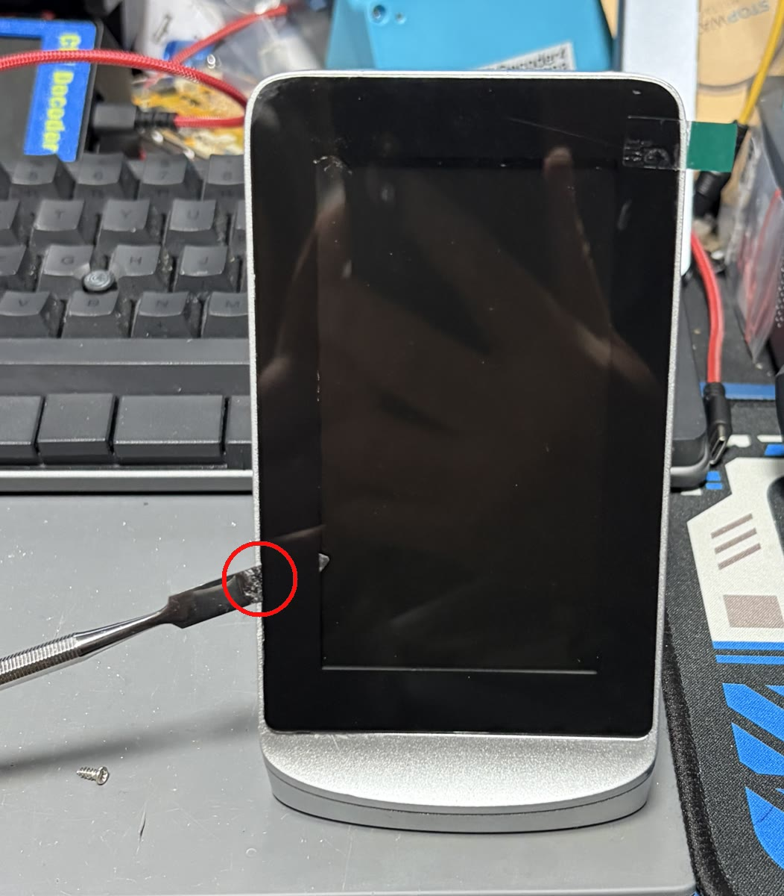
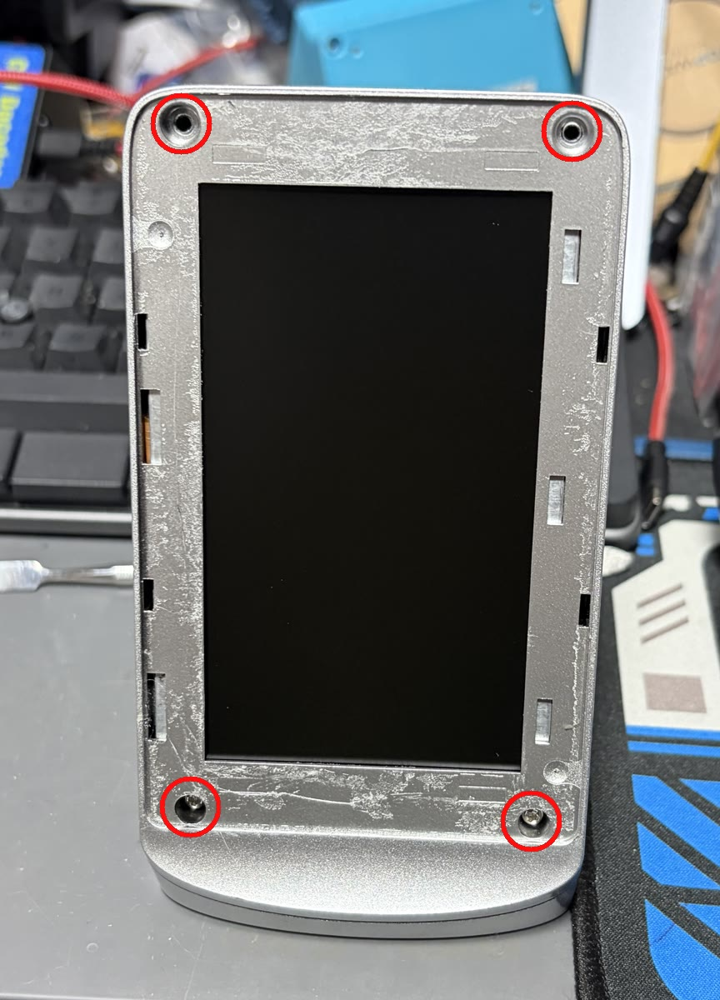
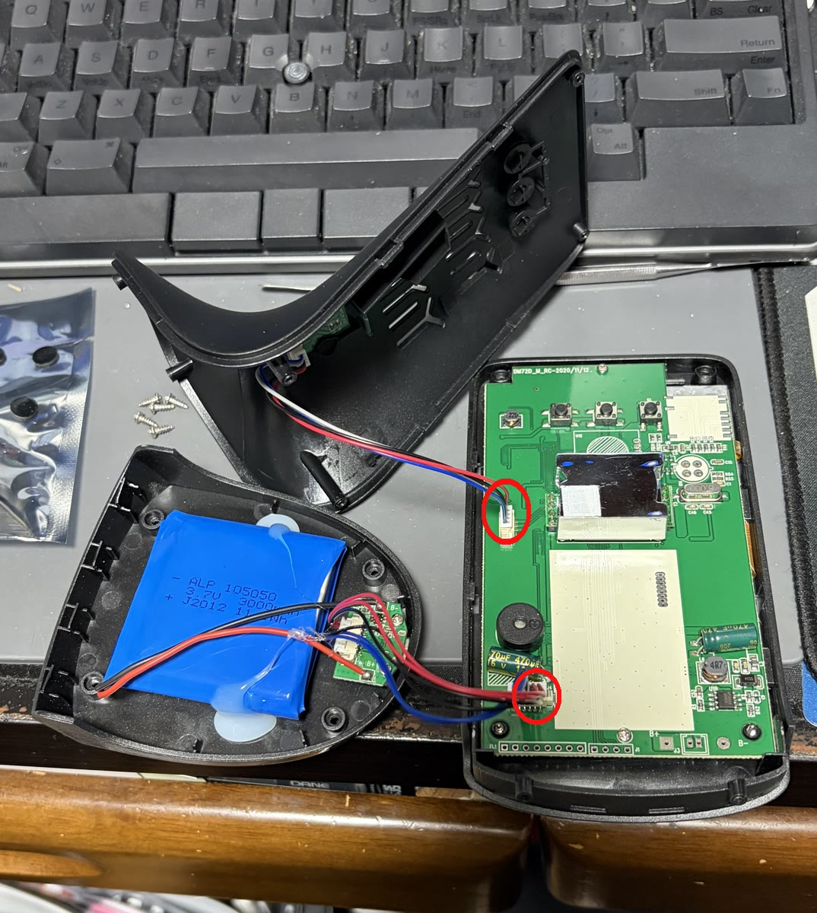
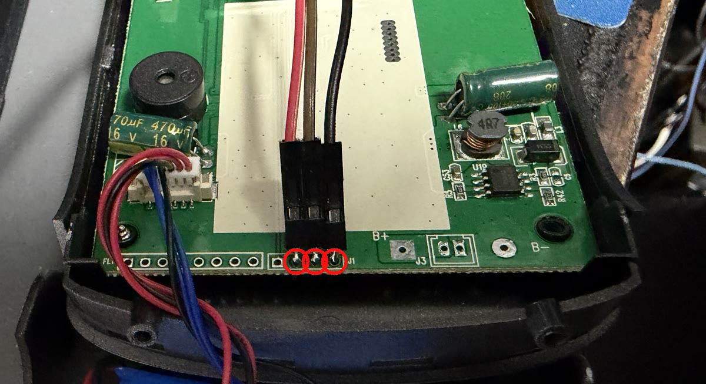
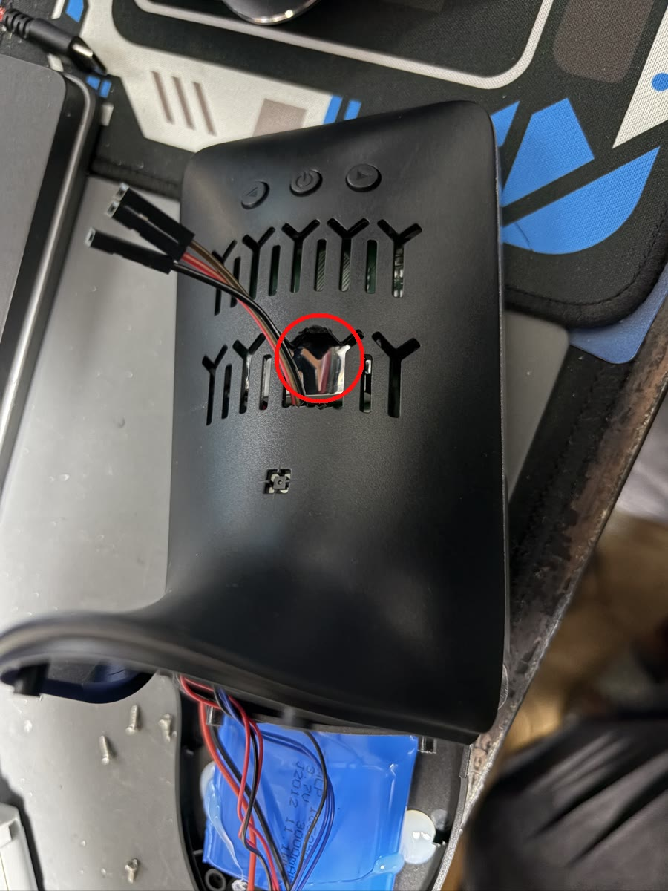
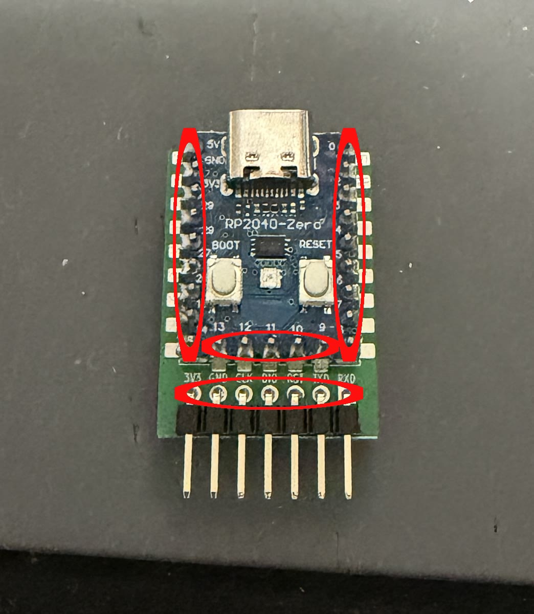
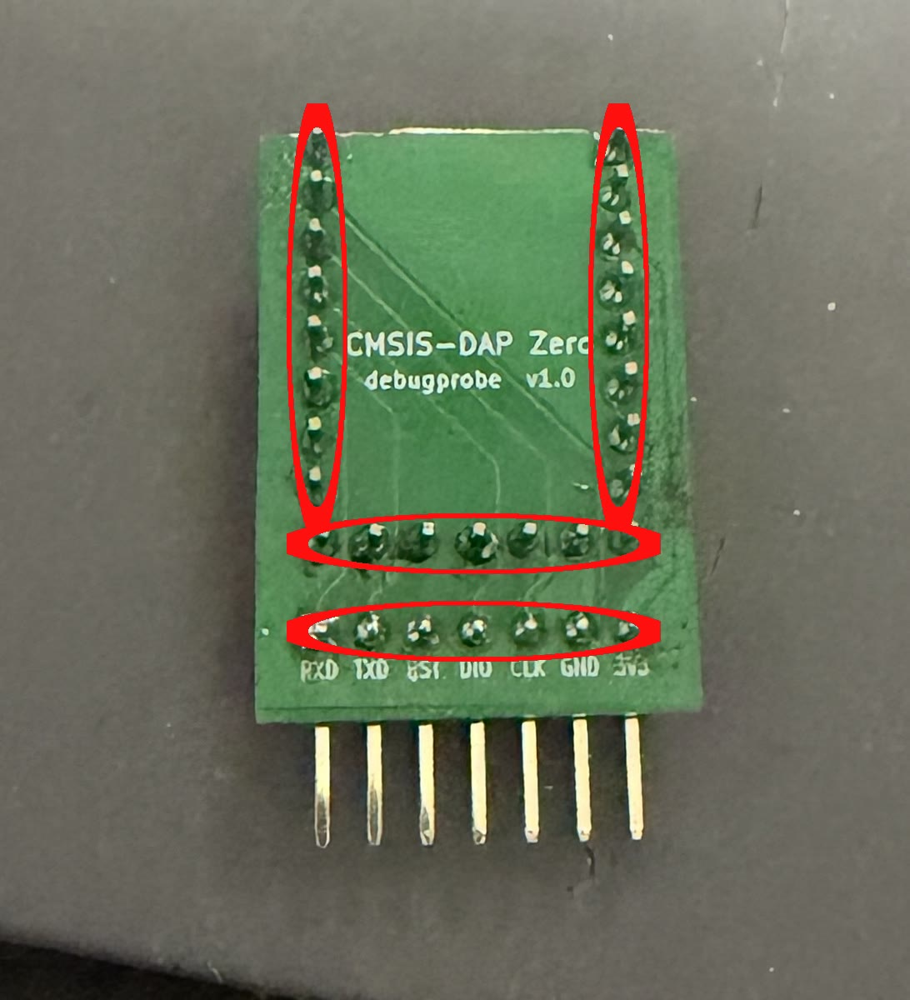
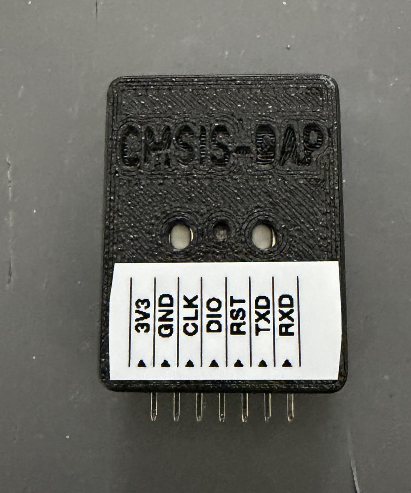
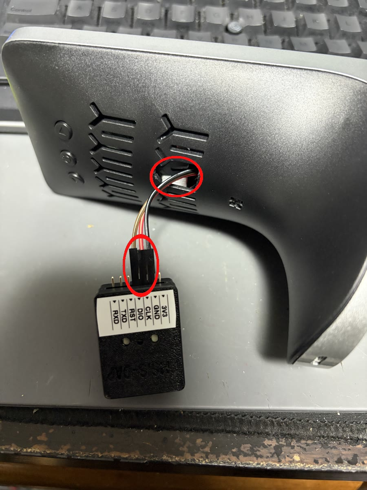

# 組立手順

DM72Cを分解してJ1にピンヘッダをハンダ付けし、デバッガ（RP2040-Zero＋CMSIS-DAP Zero基板）をつなぐまでの手順。J1のピン配置、デバッガのファーム、接続確認は [debugger_connection.md](debugger_connection.md) を参照。

写真の赤丸は、外すネジ、ハンダ付けする箇所、作業する箇所を示す。元の写真は `img/1.jpeg`〜`img/10.JPG`、赤丸付きの縮小版は `img/assembly/` にある。

## 必要なもの

- プラスドライバー（小）
- ヘラ（スパッジャー）など、薄くて硬い工具
- ハンダごて、ハンダ
- 3ピンのピンヘッダ（2.54 mmピッチ）とジャンパーワイヤー（メス）3本
- RP2040-Zero、CMSIS-DAP Zero基板（debugprobe v1.0）、7ピンのピンヘッダ
- 背面カバーに穴を開ける工具（ニッパー、リューターなど）

## 1. 前面パネルを外す

前面のアクリルパネルは両面テープで貼られている。パネルの縁にヘラを差し込み、少しずつこじって外す。アクリルを割ったり曲げたりしないよう、力をかけすぎない。

## 2. 前面のネジを外す（4本）

パネルの下にあるフレームの四隅のネジ4本を外す。

## 3. 底面のネジを外す（4本）

台座の底面のネジ穴にはゴム足が付いているので、先にゴム足を外してから、ネジ4本を外す。ゴム足は組み立てのときに戻すので、なくさないように保管しておく。

## 4. ケースを開ける

ケースは、背面カバー、台座（バッテリーとサブ基板が入っている）、前面フレーム（メイン基板が付いている）の3つに分かれる。それぞれがケーブルでメイン基板とつながっているので、引っ張らないように開く。作業しにくい場合は、赤丸の2つのコネクタ（背面カバー側のケーブルとバッテリー側のケーブル）を抜く。

J1があるのはボタン面なので、メイン基板をフレームから外す必要はない。

## 5. J1にピンヘッダをハンダ付けする

J1は基板下端中央のシルク`J1`の左にある4つの穴。左端の四角いパッドが1番ピン（3.3 V）。

右側の3ピン（2番SWCLK、3番SWDIO、4番GND）に3ピンのピンヘッダを立ててハンダ付けする。**1番ピン（3.3 V）は使わないので空けておく**。デバッガから基板へは給電しない。

ハンダ付けしたら、ジャンパーワイヤー3本を挿す。

| J1のピン | 信号 | デバッガ側 |
|---:|---|---|
| 1（左端、四角いパッド） | 3.3 V | 接続しない |
| 2 | SWCLK | CLK |
| 3 | SWDIO | DIO |
| 4（右端） | GND | GND |

## 6. ケーブルを背面カバーから出して元に戻す

背面カバーの通気口の一部を切り広げて穴を開け、ジャンパーワイヤーを外に出す。ケーブルを挟み込まないように注意して、手順4〜1の逆の順でケースを組み立てる（抜いたコネクタを挿し直し、底面のネジ4本を締めてゴム足を戻し、前面のネジ4本を締めて、前面パネルを貼る）。

## 7. デバッガを組み立てる

RP2040-ZeroをCMSIS-DAP Zero基板に載せ、周囲のピンをハンダ付けする。下側には7ピンのピンヘッダ（3V3、GND、CLK、DIO、RST、TXD、RXD）をハンダ付けする。

表から見たハンダ付け箇所：RP2040-Zeroの左右の列、下の列、7ピンヘッダ。

裏から見たハンダ付け箇所：

RP2040-Zeroにdebugprobeファームを書き込む手順は [debugger_connection.md](debugger_connection.md) の「デバッガの作り方」を参照。

## 8. ケースに入れる

デバッガをケースに入れる。ピン名のラベルを貼っておくと、つなぎ間違えを防げる。

## 9. デバッガをつなぐ

本体から出したジャンパーワイヤーを、デバッガのGND、CLK、DIOにつなぐ（手順5の表を参照）。3V3にはつながない。

接続の確認は [debugger_connection.md](debugger_connection.md) の「接続確認」、書き込みは [flashing.md](flashing.md) を参照。
